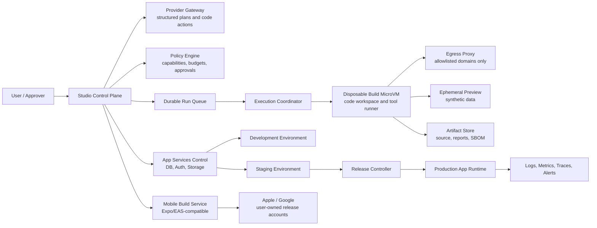

# BlackWaterLeaf Studio — Ultimate Product Benchmark and Reference Architecture

**Decision brief date:** 19 September 2026  
**Author:** Manus AI  
**Scope:** Product strategy and reference architecture for a safe, reliable full-stack application builder.  
**Evidence boundary:** Findings marked **Verified** are limited to the supplied independent product research and the local architecture-gap audit. Findings marked **Recommendation** are design choices for BlackWaterLeaf Studio, not claims about the current product or a competitor.

## Executive decision

**Recommendation — build a bounded, web-first application factory, not a general-purpose autonomous computer operator.** The Ultimate product should take a user from an approved product brief to a versioned codebase, isolated preview, managed application services, tested staging release, controlled production deployment, and exportable source. It should later produce native iOS and Android applications from an explicit mobile project profile. It should not promise that an arbitrary web project can be converted into a native app at the end.

BlackWaterLeaf Studio already has a credible **control-plane foundation**: workspace roles, task and approval records, safety limits, an atomic run claim, a persistent run queue with leasing and retry/dead-letter states, an active kill-switch path, evidence packs, an Expo approval client, a deny-by-default policy engine, workspace-scoped artifacts, a server-side Kimi gateway contract, and a Manus-backed control-plane worker. The local implementation still does **not** have an isolated worker that executes generated code, a task-scoped secret broker, an enforced egress proxy, or a verified app-build/test/release pipeline. Therefore Studio must not yet describe a task as a successful autonomous app-build run merely because the Manus planner returned a result.

The shortest reliable route is to preserve the existing web application as the **control plane** and add a separate execution plane. The control plane owns identity, workspaces, plans, policies, approvals, budgets, audit evidence, and release decisions. The execution plane runs untrusted generated code inside disposable microVMs, through an egress proxy and capability checks. The generated app runs on separately managed preview, staging, and production infrastructure. This division adopts the useful product pattern visible in Manus, Replit, Lovable, Bolt, and v0 while avoiding their most expensive nonessential feature: broad, interactive computer use. [2] [7] [11] [14] [17]

> **Decision rule:** A feature is “Ultimate” only when its source, environment, data changes, deployment, tests, and rollback path are reproducible and reviewable. A polished preview alone is not a real application.

## What the benchmark establishes

### Verified product facts

The benchmarked products establish a consistent minimum bar for a credible prompt-to-app product. Manus documents full-stack web generation with managed database, authentication, storage, preview, deployment, source export/GitHub synchronization, and a guided Android AAB/iOS TestFlight packaging path. It also makes plan confirmation an explicit optional pre-execution gate. [2] [3] [4] [5] [6]

Replit establishes the strongest directly comparable editor-and-test loop: a natural-language agent can modify a project, the user can edit source in Project Editor, inspect a live preview and browser diagnostics, and use agent-driven browser testing for supported web-app stacks. It supports React Native/Expo project creation and mobile simulator/device previews, while its formal Google Play publishing path remains unestablished. [7] [8] [9]

Lovable and Bolt demonstrate that an app builder can combine direct source access, visual iteration, managed backend primitives, explicit publish actions, and version history. Lovable’s officially documented output is a web app rather than a native mobile binary. Bolt can create an Expo-compatible project, but store delivery requires code export and external Expo/EAS workflows; it cautions that web projects do not easily become mobile later. [11] [12] [13] [14] [15]

Vercel v0 documents agentic web-app generation, direct file editing, a per-chat sandbox preview, external database/auth/storage integrations, and Vercel deployment. Its official materials do not establish React Native/Expo generation or native store packaging. Cursor demonstrates a strong developer-agent pattern—isolated cloud execution, reviewable code changes, browser verification, and pull-request handoff—but is not a managed database/auth/storage product. [17] [18] [20] [21]

Kimi Code is a local coding agent, while Kimi Websites/Kimi Agent is the separately documented web-app builder. The latter can generate, preview, version, publish, and export a database-backed website, but its own documentation positions it for prototypes and simpler websites rather than high-availability, long-term custom-domain production hosting. Native app delivery is not documented. [22] [23]

The local Studio audit confirms that the current product is behind every full-stack builder in one decisive way: it has planning and governance objects plus a control-plane queue, but no validated application-build execution plane. It still lacks per-tool enforcement at the actual executor boundary, task-scoped secrets, egress control, production observability, and app-build/test/release gates required to turn a model plan into a safe application build.

### Recommendation: the product position to own

BlackWaterLeaf should position Ultimate as **“governed app construction for teams that need a real codebase and controlled releases.”** The product should be better than a chat-to-preview experience in three areas: (1) policy-bound execution, (2) reproducible app environments and release evidence, and (3) source and data portability. It does not need to win on arbitrary web browsing, desktop control, a giant connector catalog, or fully unattended publishing.

This position is differentiated because it treats the model as an untrusted planner and code author rather than as the authorization authority. The principle matches the existing audit’s requirement that policy be evaluated outside the model before every tool call and that approvals bind the exact normalized action, target, policy version, expiry, and one-time execution identifier. [1] [25]

## Compact benchmark comparison

| Product | Verified web-app baseline | Verified native-app path | Product lesson for Studio | Boundary Studio should retain |
|---|---|---|---|---|
| **Manus** | Prompt-to-full-stack app, managed infrastructure, previews, publishing, source export/GitHub sync. [2] [3] | Android AAB and iOS/TestFlight preparation; account owner performs store release. [5] | One product can make the full web journey approachable. | Do not copy general Cloud Browser/Desktop autonomy as a prerequisite for app building. |
| **Replit Agent** | Prompt, direct code editing, preview/debug tools, managed data/auth/storage, publish, browser self-test. [7] [8] | React Native/Expo preview and iOS guidance; Google Play publishing is not yet documented. [9] | Pair an agent with a genuine code workspace and test feedback. | Do not make agent spending, build execution, and production hosting an opaque pooled charge. |
| **Lovable** | Prompted web apps, direct source editing/Git sync, preview, Cloud or Supabase backend, security scans. [11] [12] | No documented native customer-app build/output. [13] | Backend permissions and publish approval can be first-class UX. | Keep preview data isolated from production; Lovable notes a shared-backend caveat. [12] |
| **Bolt.new** | Prompted web/full-stack app, Code view, visual edit batches, Cloud backend, explicit publish/update. [14] | Expo project export; external Expo/EAS and store accounts complete delivery. [15] | Explicit “save changes” and publish roles are good control points. | Do not promise one-click store release or a web-to-native conversion. |
| **Vercel v0** | Agentic web app, direct editing, microVM-backed preview, integrations, Vercel release. [17] [18] | No documented native-app generation or store packaging. | Sandbox preview plus Git/PR-aware release is a productive developer path. | Do not treat a short-lived build sandbox as production hosting. |
| **Cursor** | Agent creates/changes code, runs tests, browser-checks, and produces reviewable branches/PRs. [20] [21] | No managed build/sign/distribution service verified. | Separate agent execution from developer review and source control. | Do not become a BaaS or a universal code editor before core releases work. |
| **Kimi Code / Websites** | Local coding agent; separate website builder creates/exports simple full-stack websites. [22] [23] | No verified native-output path. | Lower-cost model routing can be useful behind a controlled gateway. | Do not rely on a prototype-oriented hosted site as a production runtime. |

**Verified pricing context:** published entry prices are not total cost of ownership. Manus Pro starts at US$20/month for 4,000 monthly credits, with cloud/AI/API usage for hosted apps charged separately after allowances. Replit Core is US$20/month and Pro is US$100/month, with AI and deployment consumption metered. Lovable Pro begins at US$25/month for 100 credits; Bolt Pro is US$25/month; v0 Plus is US$30/user/month; Cursor Pro is US$20/month but is not a managed BaaS; Kimi Code lists a US$19 month-to-month Plus plan. Prices, included units, infrastructure, and model use differ materially, so none is an apples-to-apples all-in price. [6] [10] [16] [19] [24]

## The Ultimate product: capability contract

### Must include to build real web applications

**Recommendation — an Ultimate build is a controlled lifecycle, not an LLM response.** The following capabilities form the minimum complete contract.

| Capability | Why it is required for a real application | Minimum acceptance condition |
|---|---|---|
| **Prompt intake and project brief** | Converts an ambiguous request into a constrained product requirement. | Captures audience, data class, integrations, target platforms, budget, environment, and nonfunctional requirements. |
| **Reviewable planner** | Users must approve scope before compute, data, or integrations change. | Produces editable structured plan, risk register, capability manifest, test plan, estimated budget, and explicit exclusions. |
| **Versioned code workspace** | Users need inspectable, portable source rather than a platform-only artifact. | Git repository, readable file tree, diffs, search, direct edit, branch/patch model, dependency lockfile, SBOM, and export. |
| **Isolated build execution** | Generated code and package installation are untrusted. | Disposable per-run microVM, non-root execution, resource quota, no host mounts, cleanup proof, and deny-by-default network. |
| **Test-and-repair loop** | A generated interface is not proof of functional behavior. | Lint, typecheck, unit tests, build, dependency/security scan, browser E2E tests, test evidence, bounded repair iterations. |
| **Preview and staging** | Users need a functional review surface without contaminating production. | Isolated, authenticated preview URL per build/environment; seeded synthetic data; expiry; logs and screenshots. |
| **Database, auth, and storage** | Most useful apps require persistent state and identities. | Managed per-environment data service, migrations, authorization model, backup/restore, encrypted object storage, auditable access. |
| **Controlled deployment** | Real applications must have a repeatable release mechanism. | Immutable artifact, environment configuration, release approval, health checks, canary or staged rollout, domain/TLS, observability. |
| **Rollback and recovery** | Code and data failures are inevitable. | One-click code rollback, explicit migration strategy, database point-in-time recovery, restore drill, and documented recovery objective. |
| **Native project profile** | Native apps require different runtime, signing, device testing, and store workflows. | Shared domain/API contracts plus an Expo/React Native package, signed build handoff, device testing, and human-owned store release. |
| **Evidence and human approvals** | Teams must establish who authorized sensitive activity and what ran. | Immutable-ish signed action receipt containing plan, actor, policy, normalized parameters, image/code digest, test result, decision, and timestamps. |

The source code, generated migration files, dependency lockfile, application configuration schema, infrastructure manifest, and release evidence must always remain exportable. The Ultimate product may host these artifacts, but it must not make the customer’s production app unrecoverable without the builder.

### Must-have / Should-have / Not-now priorities

| Priority | Scope | Decision rationale |
|---|---|---|
| **Must-have: months 0–6** | Durable runs/queue/leases; per-run microVM execution; independent policy engine; task-scoped secret broker; egress allowlist proxy; code workspace with Git/export; planning and approval gates; preview/staging separation; managed database/auth/storage integration; test loop; deployment, code rollback, backup/restore; structured audit receipts; budgets and kill switch. | These close the gaps that currently prevent Studio from safely building a web application. They also establish the minimum reliability and safety bar. [1] [25] [26] [27] |
| **Should-have: months 6–12** | Visual selection edits; design-system templates; reusable backend blueprints; branch/PR review; SBOM and dependency update workflow; browser replay; SSO/RBAC refinements; SIEM export; private networking option; Expo/React Native mobile profile; cloud build and TestFlight/AAB handoff; team policy packs. | These materially improve adoption and enterprise readiness after the controlled web build path is proven. |
| **Not now** | Arbitrary local desktop control; arbitrary authenticated browser control; agent marketplace; broad third-party connector marketplace; custom hypervisor; self-built container runtime; self-hosted model serving; 100-agent swarm; automatic public App Store/Play Store release; global active-active multiregion; bespoke database engine; autonomous payments, external messages, deletions, or production deployment. | These add material attack surface, operating cost, or product scope without being required to deliver dependable web apps. The local audit independently reaches the same conclusion for a custom hypervisor, large swarm, desktop-per-task, nested virtualization, connector marketplace, and autonomous high-risk actions. [1] |

**Recommendation — do not defer native architecture decisions until month 12.** Defer the native *delivery feature*, not the project boundary. At project creation, let users choose **Web only** or **Web + Native**. The latter starts from a monorepo with shared types, domain validation, API client, design tokens, and test fixtures, but separate web and React Native user interfaces. This avoids the false promise that a responsive web codebase will later become a native application without rework. Bolt’s own documentation supports this caution. [15]

## Where BlackWaterLeaf Studio currently lags

### Verified gaps from the existing audit

| Current state | Consequence | Release implication |
|---|---|---|
| **Control plane and planner exist; real sandbox worker does not.** | The product cannot safely execute generated code or tools. | Keep execution capability disabled or clearly labeled non-operational until the runtime acceptance gate passes. |
| **Persistent queue/worker is now present, but only the Manus control-plane runner is real.** | Runs survive request boundaries, but no generated code is executed or tested in an isolated environment. | Keep the execution capability disabled until the worker acceptance gate passes. |
| **Policy engine and approvals exist, but no complete tool executor enforces them.** | A future model/tool integration could still become the effective authorizer. | Put an independent policy decision point at every executor call and bind approval to the exact action hash. |
| **No secret broker or scoped credentials.** | Process environment variables risk exposure to prompts, logs, artifacts, or a future worker. | Use short-lived, run- and capability-scoped credentials injected only at tool execution. |
| **No enforced egress boundary.** | Package installation, browser actions, and generated code can become an exfiltration or SSRF path. | Deny network by default; force all egress through an audited proxy. |
| **Artifacts are stored with workspace isolation and hashes, but no malware/content scanner is attached.** | Uploaded files can become a supply-chain or data-leakage input to future agents. | Add file-type validation, malware scanning, quarantine, retention, and scan receipts before execution. |
| **Static health/development logs and a still-narrow test suite.** | The product cannot demonstrate reliable recovery, tenant isolation, security controls, or production readiness. | Add correlated telemetry, release gates, abuse tests, restore drills, and representative Golden Tasks. |
| **Expo approval client exists, not a mobile build/distribution plane.** | Mobile approvals are useful, but native app output is not yet an application-builder capability. | Treat mobile as a later build/sign/handoff workflow, not as a current promise. |

These are **P0 architecture gaps**, not polish issues. The current local commit was successfully type-checked, tested, and production-built according to the audit, but those validations do not prove actual code, browser, filesystem, network, or provider execution. [1]

### Recommendation: specific closure order

Do not add a visual app canvas or broad autonomous tools first. The Manus provider and durable queue are now available, but a run must only transition to **succeeded** after an execution worker result, test gate, artifact integrity check, and required approval are all verified. Keep the first executor tool set narrow and read-mostly. The initial write action should be `create_draft_patch`, not direct production mutation. The appropriate starting boundary remains context search, bounded file reads, asset metadata, linted preview, tests, draft patch, and approval request.

## Concrete App Builder Reference Architecture

### System boundaries and trust model

**Recommendation — use three planes and four environments.** The Studio control plane should remain separate from both agent execution and customer-facing application runtime.

**Control plane.** Preserve the existing React/Tailwind, tRPC, Manus OAuth, MySQL/Drizzle application as the system of record for workspace membership, project metadata, task and run state, approvals, policy versions, budgets, and evidence. It should never hold long-lived customer-app secrets in browser state. Its job is coordination, policy, and audit—not running untrusted code. [1]

**Execution plane.** A coordinator consumes a leased job and creates one disposable Firecracker microVM or equivalent dedicated VM per untrusted build/test run. A microVM is a stronger primary tenancy boundary than a standalone multi-tenant container; containers can be used inside the VM for packaging. The image must run as non-root with a read-only base, no host mounts, stripped capabilities, seccomp/AppArmor, cgroup CPU/RAM/process/disk/I/O/runtime ceilings, and enforced cleanup. The coordinator, rather than the task process, must retain an external kill channel. [1] [27] [26]

**Application runtime plane.** Generated applications should deploy to managed web runtime infrastructure that is separate from the build VM. Each app has at least preview/staging and production environments. Customer traffic never enters the Studio control-plane database, and a preview never shares production credentials or production data by default.

### End-to-end build path

| Stage | Required implementation | Safety/reliability control | Human decision |
|---|---|---|---|
| **1. Prompt intake** | Collect brief, attachments, selected template, platform choice, data classification, integration list, and maximum budget. Strip/label untrusted attachment text. | Prompt-injection screening; provenance labels; no tool access in intake. | User submits request. |
| **2. Planner** | Server-side provider gateway returns a schema-validated plan: requirements, file/change plan, service manifest, data model, migrations, test cases, permissions, external domains, cost estimate, and risk classes. | Structured output validation; maximum tokens/tool calls/agents; unknowns become questions. | User accepts, revises, or rejects plan. |
| **3. Policy compilation** | Convert plan to a signed capability manifest with exact allowed tools, paths, domains, methods, budget, expiry, and environment. | Independent policy engine evaluates every normalized call; model cannot grant itself access. | Approver grants baseline build scope. |
| **4. Code workspace** | Create project Git repository and run branch; materialize template, lockfile, code, migrations, infrastructure manifest, and direct editor. All agent writes occur as patches/commits. | Per-run VM; read-only base image; signed image digest; artifact hashes; dependency allowlist; no raw production secrets. | Draft code changes may be auto-applied within approved project scope. |
| **5. Test loop** | Run format/lint/typecheck/unit/build/security/SBOM checks, then bounded browser E2E tests against the isolated preview. Agent receives sanitized failures and may repair within a fixed retry budget. | Test data only; browser limited to preview origin; no external authenticated browser profile; failed gate blocks promotion. | User sees failures/diffs; overrides require elevated role and recorded reason. |
| **6. Preview** | Publish time-limited, authenticated preview from immutable build artifact; support desktop/tablet/mobile viewport and route testing. | Separate preview DB/storage/auth tenant or namespace; auto-expiry; rate limits; watermark “Preview.” | Product owner accepts preview for staging. |
| **7. Database/auth/storage** | Provision application services from approved manifest. Use migrations, row/tenant authorization policies, identity provider configuration, encrypted object storage, and audit logs. | Environment separation; secrets broker issues service-specific tokens; destructive migration and privileged identity changes are approval-gated. | Data owner approves schema/data migration and auth-policy changes. |
| **8. Deployment** | CI-like release controller promotes signed artifact to staging, executes smoke tests, then deploys production through immutable version/release record. | Change window, health checks, canary/blue-green when justified, monitoring, automatic rollback threshold. | Release approver authorizes production promotion and public-domain change. |
| **9. Rollback/recovery** | Retain prior artifact, deployment manifest, DB backup/PITR point, and migration state. Use expand/contract migrations rather than unsafe immediate destructive changes. | Code rollback is separate from data restore; restore requires confirmation and a runbook; quarterly restore test. | Incident commander or delegated approver authorizes data restore. |
| **10. Native build** | For Web + Native projects, build Expo/React Native packages from a separate app package using shared contracts. Submit signed AAB/IPA/TestFlight artifacts to the account holder. | Hardware/device test suite; signing keys in external secret store; no direct public-store publish by default. | Account owner reviews TestFlight/internal track, release notes, store listing, and performs final store release. |

### Prompt, planning, and provider gateway

**Recommendation — use Kimi as a provider behind Studio, never from the browser.** The gateway should expose a stable internal contract rather than leak a model-specific API into project code. It validates structured output, reconstructs fragmented tool calls, records token/cost usage, supports streaming status events, applies timeouts, uses model fallback only when policy permits, and redacts reasoning from the user-facing audit stream. The existing audit recommends Kimi K2.7 Code for coding/debug/testing and K3 only for genuinely large planning/reduction tasks; use a smaller/cheaper approved model for classification and form completion. [1] [22] [28]

A planner does not receive broad source history or secrets by default. It receives only the project brief, selected template manifest, approved code excerpts, stable summaries, and explicit user inputs. Retrieval must be workspace-scoped and provenance-tagged. Each plan must include an **assumption list** and a **“cannot safely infer”** section so that the product asks for clarification rather than silently broadening scope.

### Code workspace and test loop

**Recommendation — make a true but deliberately narrow code workspace a Must-have.** Users need file browsing, full-text search, diff review, direct source changes, terminal *output* viewing, Git status, dependency lockfile visibility, and export/clone. They do not need an in-browser replacement for every desktop IDE in the first year. The agent uses a branch or draft patch; a user can inspect and edit that branch before promotion. This borrows the practical benefit of Replit, Lovable, Bolt, v0, and Cursor without turning Studio into a generic developer desktop. [7] [11] [14] [17] [20]

The repair loop must be bounded by policy: for example, no more than three automatic repair cycles or a per-plan build budget. Each loop records failing command, sanitized output, code diff, test result, and cumulative spend. Browser testing should use seed accounts and synthetic payment/email adapters. It should never silently access a user’s live browser, personal cookies, or external authenticated systems. OWASP identifies prompt injection, excessive agency, insecure output handling, and sensitive-information disclosure among relevant agentic risks; isolation and tool constraints are therefore architectural controls, not optional telemetry. [25]

### Preview, data services, and release separation

**Recommendation — make isolation visible in the UI.** Each preview should display the build SHA, environment, expiry, data source, and whether it contains synthetic data. Preview links are private by default and expire. A user should not be able to mistake a preview for production, nor should an agent be able to promote it by simply reporting that it “looks correct.”

For generated applications, begin with a vetted managed PostgreSQL-compatible service, managed identity service, and S3-compatible object storage behind Studio abstractions. This is cheaper and more reliable than operating a new database/auth/storage stack. Use a distinct database or strongly isolated namespace and credentials per app environment. Auth must support branded application identities, user roles, password/reset/email verification flows where enabled, OAuth/OIDC only after approved client configuration, and audit visibility. Storage must use signed upload/download URLs, malware/file-type scanning policy, bucket-per-environment or equivalent isolation, lifecycle deletion, encryption, and quotas.

The system must apply database migrations as versioned artifacts. A preview schema migration and a production schema migration are different operations. No code-version rollback claim may imply data rollback; both Lovable and Bolt document database rollback limitations, which reinforces this design requirement. [12] [14]

### Deployment, rollback, and operations

The deployment controller should only accept a release candidate that carries a signed source revision, SBOM, image digest, tested migration set, environment configuration reference, passed test evidence, and approved release record. It should deploy to staging first, run smoke tests, then await a production approval for high-risk applications. Production must include HTTPS/TLS, secret injection at runtime, health probes, structured logs, metrics, traces, error tracking, cost metering, rate limits, alerts, retention policy, and runbooks.

Rollback has three distinct modes: **code rollback** to a previously verified artifact; **traffic rollback** away from a bad deployment; and **data recovery** from a selected backup/PITR point. The UI must show that data recovery can discard newer writes. Destructive schema operations require an expand/contract plan, backup confirmation, and elevated approval. Backup and restore must be practiced, not merely configured. The existing audit makes backup/restore, rollback, error tracking, dashboards, and failure/recovery tests explicit enterprise requirements. [1]

### Human approvals: use boundary approvals, not approval fatigue

**Recommendation — require people at irreversible or externally consequential boundaries, not on every file edit.** A plan approval unlocks bounded build activity. A tool-policy decision controls each call automatically within that approved envelope. Separate user approvals are required for an action that crosses a data, money, identity, public-release, or privilege boundary.

| Action class | Default policy | Required approval evidence |
|---|---|---|
| Read approved project files; create draft patch; run local lint/tests; preview synthetic data | Allowed within active plan and budget. | Capability manifest, run ID, policy version, tool receipt. |
| Add dependency; execute networked package install; create preview database; non-destructive schema migration | Ask once per normalized action or pre-approved template scope. | Domain/package/migration hash, budget impact, expiry. |
| Read customer data; invoke third-party API; configure external OAuth; create storage bucket; alter authorization policy | Explicit data/integration owner approval. | Data class, target, operation, scopes, retention, policy decision. |
| Delete/transform production data; rotate/issue privileged secrets; change billing; send external message; deploy public production release | Step-up authentication and optional four-eyes rule. | Action hash, named actor(s), rationale, one-time nonce, expiry, release/test evidence. |
| Public App Store/Google Play release | Always user-controlled outside default agent authority. | Store-account owner confirmation; release artifact and checklist. |

Every approval must be atomically consumed by the exact execution request. The receipt must link actor, workspace, project, tool/action, normalized parameters, target, data class, policy version, expiry, cost, image digest, code SHA, and result. The existing Studio evidence-chain foundation is a valuable starting point, but it must be connected to actual worker and release events. [1]

## Cost-control model: lower cost than Manus without lowering the safety bar

### Verified market constraint

Manus’s entry subscription is inexpensive at US$20/month, but it meters active task work by model tokens, virtual machines, and third-party APIs. Its published web-app infrastructure is separately usage billed after allowances; autoscale has no idle charge while a continuously reserved process can approach US$36/month at full utilization. [6] The correct comparison for BlackWaterLeaf is therefore **cost per successful, governed application change**, not the headline subscription price.

**Recommendation — do not claim “cheaper than Manus” for a lightly used single user until Studio’s full fixed security and support cost is measured.** A microVM, queue, audit, backup, and support baseline may cost more than a US$20 seat at very low utilization. Studio can become cheaper on a unit basis for focused app-building workloads by refusing expensive, general-purpose autonomy and by metering transparent units with hard limits.

### Cost equation and chargeable units

Use a visible internal and customer-facing rate card. For each run:

> **Run cost = planner-token cost + code/test-token cost + (microVM vCPU-seconds × rate) + (GiB-RAM-seconds × rate) + network-egress cost + preview/runtime cost + database/storage cost + observability/security allocation + mobile-build cost.**

Monthly cost is the sum of run costs plus the workspace control-plane allocation and production application infrastructure. The UI should show both **actual accrued cost** and **maximum authorized cost** before and during a run. Never hide model retries, browser tests, or deployment usage inside an unexplained “credit” balance.

| Cost lever | Recommendation | Why reliability or safety is preserved |
|---|---|---|
| **Bound the product surface** | Build project-scoped app code, not arbitrary cloud-browser or desktop tasks. | Eliminates a high-cost, high-risk class of workloads while retaining app-builder value. |
| **Route models by difficulty** | Use a lower-cost approved model for classification/planning fragments; Kimi K2.7 Code for code/test work; reserve K3 or premium reasoning for explicit complex-plan exceptions. | Policy, testing, and approvals—not model price—protect correctness. [1] [28] |
| **Use templates and deterministic generators** | Start from maintained stack templates, schema blueprints, design tokens, and integration adapters. | Fewer model turns and fewer dependency surprises improve repeatability. |
| **Use disposable VMs with cold start initially** | Use immutable images and aggressive teardown; introduce warm pools only after measured utilization. | Strong isolation and cleanup remain; idle capacity is not paid for prematurely. |
| **Cache safely** | Cache public package artifacts and signed base images outside tenant workspaces; reuse only content-addressed, vulnerability-scanned layers. | Avoids repeated downloads without sharing customer code or secrets. |
| **Progressive test tiers** | Run lint/typecheck/unit/build first; run browser E2E only for changed critical paths or pre-release. | Maintains release quality while controlling the most expensive interactive test loops. |
| **Preview TTL and quotas** | One active preview per branch by default; sleep/expire previews; retain artifacts rather than live environments. | Users still receive reviewability; production is unaffected. |
| **Managed data primitives** | Buy mature DB/auth/storage rather than operate bespoke infrastructure; set per-app quotas and lifecycle policies. | Reduces operations burden while maintaining backup, encryption, and isolation. |
| **Commitment budgets** | Hard per-run, daily, workspace, and project spending caps; require approval to expand. | Prevents runaway agents before cost becomes an incident. |
| **Human gates at high-cost actions** | Require confirmation before premium-model escalation, large migration, full browser suite, mobile cloud build, or production release. | Human choice is focused where it reduces financial and operational risk. |

A prudent initial commercial model is a platform fee for governance and collaboration plus separately visible included units for **planned build runs, isolated build minutes, preview hours, application runtime, database/storage, and model tokens**. Users should be able to set a workspace hard cap and choose one of three actions on exhaustion: stop, ask an owner, or switch to a lower-cost approved mode. Platform-initiated failure should refund the affected metered unit. This is more transparent than making the customer infer whether a model, VM, or deployment consumed its credits.

### Unit-economics guardrails for the first release

**Recommendation — establish these non-negotiable controls before paid self-service scale.** Every run has a maximum wall-clock time, vCPU/RAM/disk/process budget, token budget, allowed domains, tool-call limit, repair-loop limit, and dollar ceiling. Every preview has an expiry. Every production app has separate infrastructure billing and an availability warning before funds are exhausted. Every workspace has owner-configurable caps. An alert at 50%, 80%, and 100% of budget should include the run, agent step, and service responsible.

The essential economy is not “use cheaper AI at all costs.” It is **make the expensive path rare**: constrain scope at planning time, reduce context with code summaries and retrieval, avoid unnecessary browser sessions, block futile loops early, and promote only tested immutable artifacts. These choices lower cost while strengthening—not weakening—safety and reliability.

## Staged 12-month roadmap

| Timing | Outcome and scope | Exit gate |
|---|---|---|
| **Months 0–1: Product truth and foundation** | Correct product language; inventory data flows; rotate exposed configuration if needed; define run/state schema, policy schema, capability manifest, audit receipt, budget model, and threat model. Restore/confirm the GitHub remote before relying on it for delivery. | UI cannot portray blocked/non-executing work as successful agent execution; security owner signs the threat model and data-flow inventory. |
| **Months 1–3: Durable orchestration and control gates** | Implement Run table, queue, job leasing, idempotency keys, retry/backoff, dead-letter state, checkpoints, resume, cancellation/kill signaling, transactional audit, and real health/metrics endpoints. Add provider gateway in read-only planning mode. | Chaos tests cover duplicate delivery, lost worker, retry, cancellation, approval expiry, and budget exhaustion. No run falsely reaches success. |
| **Months 3–5: Secure code execution MVP** | Deploy execution coordinator, disposable microVM adapter, immutable build image, resource cgroups, cleanup, egress proxy, artifact store, secret broker, narrow tool registry, and policy decision point. | Cross-tenant, SSRF, secret-redaction, sandbox-escape, prompt-injection, and kill-switch negative tests pass; independent review accepts isolation evidence. |
| **Months 5–6: Real web app inner loop** | Ship template-led planner, Git-backed code workspace, direct edits/diffs/export, lint/typecheck/unit/build loop, isolated authenticated preview, browser E2E tests, repair limits, and evidence dashboard. | At least 20 representative Golden Tasks produce source, passing tests, preview, and reproducible artifact within budget. |
| **Months 6–8: Application services and release MVP** | Integrate per-environment managed DB/auth/storage, migrations, seeded preview data, secret scopes, staging deployment, domain/TLS, production approval, code rollback, alerts, SBOM, and basic dependency scanning. | A full restore drill and rollback drill succeed; preview cannot access production credentials/data; production promotion is approval- and evidence-bound. |
| **Months 8–10: Closed beta and enterprise controls** | Run 50+ Golden Tasks across internal and design-partner apps; add RBAC refinement, SSO design/implementation as needed, structured logs/traces, SIEM export, change management, support runbooks, incident response, and usage dashboard. | Meet target success, recovery, cost, and security thresholds for four consecutive weeks; all severity-one findings have owners and due dates. |
| **Months 10–12: Native beta and scale optimization** | Introduce explicit Web + Native monorepo template, Expo/React Native build profile, simulator/device test evidence, signing-key integration, AAB/TestFlight handoff, release checklist, and mobile approval notifications. Evaluate warm pools only with real utilization data. | Internal and selected beta apps reach device test and account-owner store handoff; no automated public store release; cost per successful build meets approved target. |

**Recommendation — apply a release gate, not calendar optimism.** If the execution-security gate is not met at month five, postpone visual-canvas work and mobile beta. A feature-rich UI cannot compensate for an untrusted runtime, unbounded egress, or unrecoverable data migration.

## What can be omitted without weakening the Ultimate outcome

A credible Ultimate product **does not need** a custom hypervisor, its own container runtime, a self-hosted foundation model, a massive agent swarm, an agent-controlled desktop, or a general web-research/browser automation product. Use a proven microVM technology, managed cloud primitives, and an external provider gateway. Do not run more than a small number of specialized workers before the task model, context isolation, budgets, and failure modes are validated. The existing audit recommends an initial 2–6-worker ceiling and explicitly rejects the need for a 100-agent swarm. [1]

It also does not need a complete no-code visual design suite, a connector marketplace, multi-cloud active-active availability, third-party payment automation, arbitrary OAuth integrations, custom data-residency promises, or public-store auto-publishing in the first year. Start with a supported app stack and a small integration catalog. Each integration should be an adapter with scoped OAuth, explicit operation allowlists, redacted logs, revocation, and its own approval class. This will produce higher-quality apps at a lower support cost than promising every framework and SaaS connection.

Native mobile should be a **planned, separate runtime target**, not a mandatory first-release feature. The product can deliver genuine value with web apps, a web control plane, and mobile approvals before it offers cloud builds. However, it must preserve shared contracts and portable source from the start so that a future native package is feasible.

## Final recommendation and decision checkpoints

1. **Authorize a web-first Ultimate MVP only if the execution plane is funded as a security and reliability program, not as an LLM integration.** The current control plane is a valuable accelerator, but it cannot safely execute app-building tasks today. [1]
2. **Adopt a bounded app-builder scope.** Require plan approval, source portability, isolated execution, a managed service manifest, test evidence, environment separation, release approval, and rollback before calling an output a deployable app.
3. **Differentiate on governable delivery.** Copy the convenient lifecycle from the benchmark leaders—plan, code, preview, data services, publish, history—but make policy, evidence, budget controls, and environment separation unusually explicit.
4. **Target lower unit cost rather than a simplistic lower sticker price.** Avoid general computer use, large idle fleets, opaque credit consumption, and unlimited repair loops. Use model routing, deterministic templates, ephemeral sandboxing, progressive tests, managed infrastructure, and budget gates.
5. **Introduce native as a month-10–12 beta.** Support a deliberate React Native/Expo package and user-owned TestFlight/AAB handoff. Retain final public-store release as a human action.

## References

[1]: file:///home/ubuntu/blackwaterleaf-studio-web/docs/STUDIO_ARCHITECTURE_GAP_REPORT_2026-09-19.md "BlackWaterLeaf Studio — Architecture Gap Report, 19 September 2026"
[2]: https://manus.im/docs/website-builder/getting-started "Manus Website Builder — Getting Started"
[3]: https://manus.im/docs/website-builder/cloud-infrastructure.md "Manus Website Builder — Cloud Infrastructure"
[4]: https://manus.im/docs/website-builder/code-control.md "Manus Website Builder — Code Control"
[5]: https://manus.im/docs/website-builder/app-publishing.md "Manus Website Builder — App Publishing"
[6]: https://help.manus.im/en/articles/11711111-what-is-the-current-membership-pricing-for-manus "Manus Help Center — Current Membership Pricing"
[7]: https://docs.replit.com/features/agent/overview "Replit Docs — Agent Overview"
[8]: https://docs.replit.com/features/agent/app-testing "Replit Docs — App Testing"
[9]: https://docs.replit.com/features/artifact-types/building-mobile-apps "Replit Docs — Building Mobile Apps"
[10]: https://replit.com/pricing "Replit — Pricing"
[11]: https://docs.lovable.dev/introduction/welcome "Lovable Docs — Introduction"
[12]: https://docs.lovable.dev/features/cloud "Lovable Docs — Lovable Cloud"
[13]: https://docs.lovable.dev/integrations/lovable-mobile-app "Lovable Docs — Mobile App"
[14]: https://support.bolt.new/get-started/intro-bolt "Bolt Support — Introduction to Bolt"
[15]: https://support.bolt.new/integrations/expo "Bolt Support — Expo Integration"
[16]: https://bolt.new/pricing "Bolt — Pricing"
[17]: https://v0.app/docs "v0 Docs — Overview"
[18]: https://v0.app/docs/sandbox "v0 Docs — Sandbox"
[19]: https://v0.app/pricing "v0 — Pricing"
[20]: https://cursor.com/docs/cloud-agent "Cursor Docs — Cloud Agents"
[21]: https://cursor.com/docs/cloud-agent/capabilities "Cursor Docs — Cloud Agent Capabilities"
[22]: https://www.kimi.com/code/docs/en/ "Kimi Code — Documentation Overview"
[23]: https://www.kimi.com/en/help/websites/websites-overview "Kimi Help — Websites Overview"
[24]: https://www.kimi.com/code/en "Kimi Code — Plans and Pricing"
[25]: https://cheatsheetseries.owasp.org/cheatsheets/AI_Agent_Security_Cheat_Sheet.html "OWASP Cheat Sheet Series — AI Agent Security"
[26]: https://csrc.nist.gov/pubs/sp/800/190/final "NIST SP 800-190 — Application Container Security Guide"
[27]: https://firecracker-microvm.github.io/ "Firecracker — Secure and Fast MicroVMs"
[28]: https://platform.kimi.ai/docs/pricing/chat "Kimi Platform — Chat Model Pricing"
